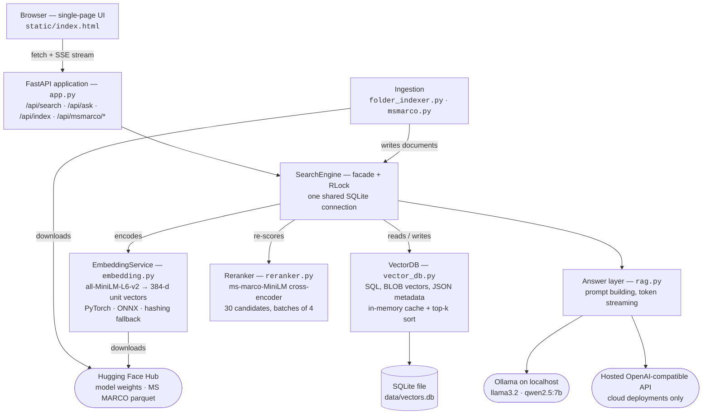
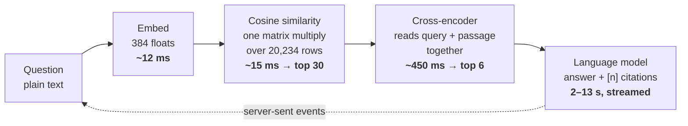

# Architecture

How the Vector Search Database works: the components, the path a question takes through
them, the data model, the stack, and what each piece measured.

Figures below were measured on the development machine with 20,234 documents indexed,
20,000 of which are MS MARCO passages.

---

## The whole system

One FastAPI process serves both the browser UI and the JSON API. Everything behind the API
goes through `SearchEngine`, a facade that owns the embedding model, the database, the
re-ranker, and a lock that serialises SQLite access across request threads.



Rounded nodes are things the process talks to: the SQLite file on disk, the Ollama server on
localhost, a hosted API in cloud deployments, and the Hugging Face Hub it downloads models and
dataset files from.

---

## What happens when you ask a question

This is the `POST /api/ask` path end to end. `POST /api/search` is identical but stops after
step 5.



Stage 1 (embed + cosine) is cheap enough to touch every document. Stage 2 (the cross-encoder)
is roughly 30× slower per document, so it only ever sees 30 of them.

1. **Embed the question.** The same MiniLM model that embedded the documents turns the question
   into a 384-dimensional unit vector, so query and documents live in one space.
2. **Load vectors from cache.** All stored vectors sit in one NumPy matrix in memory, rebuilt
   lazily after any write. Before this cache existed, a search re-read every row from SQLite and
   took 400 ms.
3. **Score and partially sort.** One matrix multiply gives every document's cosine similarity;
   `np.argpartition` pulls out the top candidates without sorting all 20,234. An optional
   category filter runs first, using SQLite's `json_extract`.
4. **Drop near-duplicates.** MS MARCO often stores a short and a long version of the same
   passage. Any candidate contained in a higher-ranked one, or sharing its first 80 characters,
   is removed.
5. **Re-rank the survivors.** The cross-encoder returns a relevance logit per candidate, squashed
   to 0–1 by a sigmoid; results are re-sorted and cut to the requested count.
6. **Send sources to the browser immediately.** The first SSE event carries the passages and
   timings, so the user sees the evidence before the model writes a word.
7. **Generate the answer.** The passages are wrapped in numbered `<source>` tags with an
   instruction to cite them, then streamed through Ollama. `[2]` or `[2, 4]` in the output becomes
   a chip that scrolls to that source.

---

## Data model

Every document — a sample sentence, a chunk of one of your files, or an MS MARCO web passage —
is one row in one table. The vector is raw `float32` bytes; everything that varies by source
lives in a JSON column, which keeps the schema stable as new ingestion paths are added.

```sql
CREATE TABLE documents (
    doc_id      TEXT PRIMARY KEY,   -- stable: sha1(path:chunk) or sha1(passage)
    text        TEXT NOT NULL,
    embedding   BLOB NOT NULL,      -- 384 float32 values = 1,536 bytes
    dim         INTEGER NOT NULL,
    metadata    TEXT DEFAULT '{}',  -- JSON, shape depends on the source
    created_at  REAL NOT NULL
);
CREATE INDEX idx_documents_created_at ON documents(created_at);

CREATE TABLE meta (key TEXT PRIMARY KEY, value TEXT NOT NULL);
-- meta remembers which embedding model wrote the vectors, so switching models
-- re-embeds every document instead of silently comparing incompatible vectors.
```

| Source | `metadata` fields |
|---|---|
| Indexed file | `category` (file type), `path`, `source`, `root`, `start_line`, `end_line`, `mtime` (integer nanoseconds) |
| MS MARCO passage | `category: "msmarco"`, `url`, `query` (the Bing question it was retrieved for), `query_type`, `selected` (human judgement that it answers that query) |

Stable ids are what make re-ingestion safe: re-importing MS MARCO or re-indexing a folder
overwrites the same rows instead of creating duplicates, because the id is derived from the
content or from the file path and chunk number.

---

## Modules

| File | Responsibility | Lines |
|---|---|---|
| `app.py` | FastAPI routes, request models, SSE streaming, background import job | 211 |
| `search_engine.py` | Facade over everything; thread lock, re-rank orchestration, duplicate removal, model-change detection | 176 |
| `vector_db.py` | SQL schema and queries, vector serialisation, cosine similarity, in-memory cache | 323 |
| `embedding.py` | Three embedding backends behind one interface | 173 |
| `reranker.py` | Cross-encoder loading and scoring, PyTorch or ONNX | 90 |
| `rag.py` | Prompt construction, three answer backends, extractive fallback, backend health | 275 |
| `folder_indexer.py` | Directory walk, chunking, incremental re-indexing | 148 |
| `msmarco.py` | Dataset download, passage extraction and de-duplication, progress reporting | 140 |
| `static/index.html` | Entire front end: search, streaming answers, data drawer, theming | 729 |
| `cli.py` | Command line: index, search, import, stats, clear | 118 |
| `server.py`, `build_data.py` | Deployment entrypoint and build-time database construction | 84 |
| `tests/` | 31 tests across four files, offline and deterministic | 505 |

---

## HTTP API

| Endpoint | Purpose |
|---|---|
| `GET /` | Serves the single-page UI |
| `POST /api/search` | Semantic search; returns results, timings, and whether re-ranking ran |
| `POST /api/ask` | Search, then stream an answer as server-sent events |
| `GET /api/stats` | Document count, categories, model names, import state, example queries |
| `GET /api/ai` | Lightweight answer-backend health, polled by the UI every 10 s |
| `POST /api/index` | Index a folder on the server's filesystem |
| `POST /api/msmarco/import` | Start a background MS MARCO import |
| `GET /api/msmarco/status` | Progress of that import |
| `GET`/`POST /api/documents` | List or add documents |
| `DELETE /api/documents/{id}` | Delete one document (omit the id to clear the collection) |
| `POST /api/samples` | Load the built-in demo corpus |

---

## Answer backends

`rag.py` tries these in order and tells the UI which one answered. None of them cost money.

| Order | Backend | Notes |
|---|---|---|
| 1 | **Ollama, on this machine** | `llama3.2` (3.2 B) or `qwen2.5:7b` (7.6 B), 4-bit quantised, streamed from `/api/chat`. Warm answers take 2–13 s. No data leaves the computer. |
| 2 | **Hosted OpenAI-compatible API** | For cloud instances too small for a local model. Any provider works through `LLM_BASE_URL`; same prompt, same streaming contract. |
| 3 | **Extractive** | No LLM: retrieved passages are split into sentences, embedded with the model already loaded, and the closest ones become the answer with source numbers attached. Runs when Ollama is off and no API key is set. |

---

## Technology stack

| Layer | Choice | Version | Why this one |
|---|---|---|---|
| Language | Python | 3.11 | The embedding and ML ecosystem lives here |
| Web framework | FastAPI | 0.115.6 | Typed request validation and native streaming responses |
| Server | Uvicorn | 0.34.0 | ASGI server; needed for server-sent events |
| Database | SQLite | bundled | A real relational store with zero setup; ships inside Python |
| Numerics | NumPy | 2.4.4 | The whole similarity search is one matrix multiply |
| Embeddings | sentence-transformers | 6.0.1 | `all-MiniLM-L6-v2`: 384 dimensions, ~90 MB, good quality for its size |
| Re-ranking | Cross-encoder | — | `ms-marco-MiniLM-L6-v2`, trained on the MS MARCO ranking task |
| Lightweight runtime | fastembed + ONNX Runtime | 0.9.0 / 1.28.0 | Same two models without PyTorch, for small cloud instances |
| Local LLM | Ollama | 0.40.11 | Runs quantised models locally behind a simple HTTP API |
| Dataset access | pyarrow + huggingface_hub | 25.0.1 / 1.26.0 | Streams MS MARCO parquet files without pandas |
| HTTP client | httpx | 0.28.1 | Async streaming to Ollama and hosted APIs |
| Front end | Vanilla HTML, CSS, JavaScript | — | One file, no build step, no framework to install |
| Tests | pytest | 9.1.1 | 31 tests that run offline in about 5 seconds |

### Tools used while building

| Tool | Used for |
|---|---|
| Git and GitHub | Version control; each commit explains a decision |
| Hugging Face Hub | Downloading model weights and MS MARCO parquet files on demand |
| Ollama CLI | Pulling and serving local models (`ollama pull`, `ollama serve`) |
| pytest | Regression tests, including a mocked LLM stream so no network is needed |
| curl | Exercising the JSON API and SSE stream directly while developing |
| Render | Cloud deployment from a `render.yaml` blueprint |

---

## Two deployments, one codebase

A free cloud instance has 512 MB of RAM and a tenth of a CPU — PyTorch alone does not fit. The
same models load through ONNX Runtime instead, producing numerically identical vectors, so a
database built in either environment works in the other.

| Concern | Local machine | Free cloud instance |
|---|---|---|
| Embeddings | sentence-transformers (PyTorch) | Same model via ONNX Runtime |
| Re-ranking | PyTorch cross-encoder | ONNX cross-encoder, 1 thread, batches of 4 |
| Answers | Ollama | Hosted API, or extractive with no key |
| Database | Persistent file, grows as you index | Built during deployment; no persistent disk |
| Memory | ~800 MB | 210 MB idle, 352 MB while re-ranking |

Batching mattered more than expected: scoring 30 passages at once on all cores needed about
790 MB and would have exhausted the instance. Four at a time on one thread does the same work
in 200 MB.

See the [Deploying to Render](README.md#deploying-to-render-free-tier) section of the README for
the deployment steps themselves.

---

## Decisions worth defending

**SQLite instead of a dedicated vector database.** Exact search over every vector is simple, needs
no extra service, and stays fast to about 100,000 documents. Past that, an approximate index
(FAISS, HNSW) or Postgres with pgvector would replace the brute-force scan — `VectorDB.search` is
the only thing that would change.

**Published models rather than training one.** Training a ranking model on MS MARCO needs a GPU and
days of compute. The project uses checkpoints already trained on that dataset, and uses the dataset
itself as searchable content — the same benefit, available immediately.

**Two retrieval stages instead of one.** The fast stage compares vectors computed independently, so
it can rank a passage about cell phones first for "who invented the telephone". The cross-encoder
reads question and passage together and corrects that, but is far too slow to run on every row —
hence 30 candidates, not 20,234.

**Incremental indexing keyed on modification time.** Re-indexing a folder only re-embeds files whose
modification time changed, and removes chunks of deleted files. Timestamps are stored as integer
nanoseconds because floating-point values did not always survive the round trip through SQLite's
JSON functions, which made unchanged files look modified — a bug the tests caught.

**The interface never pretends.** The header always names the model that answered. When Ollama is
unreachable, the answer is labelled "Quoted from your sources" and says why, instead of quietly
producing worse results under the same heading.

---

## Measured performance

| Operation | Measured | Conditions |
|---|---|---|
| Vector search | 15 ms | 20,234 documents, vectors cached in memory |
| Vector search before caching | 400 ms | Same corpus, re-reading every row from SQLite |
| Re-ranking | 450 ms | 30 candidates, PyTorch cross-encoder on CPU |
| Embedding import | 4.8 min | 20,000 MS MARCO passages, batches of 256 |
| Answer, small model | 2.6 s | `llama3.2`, already in memory |
| Answer, larger model | 13 s | `qwen2.5:7b`, warm; about 70 s on the first call while it loads |
| Test suite | 5 s | 31 tests, no network, temporary databases |
